# Phase 1: Get to know Wazuh

## What does Wazuh do, and how does an event travel from the agent to the dashboard?

Wazuh is a security platform that provides a unified view of SIEM and XDR. It is a single solution for endpoint detection and response, security information and event management, and log management. It is open-source and free to use.

An event travels like this:

1. The agent on the monitored machine collects it.
2. The agent sends the event, encrypted, to the Wazuh manager on port 1514.
3. The manager decodes the event and checks it against the rules, if a rule matches, it creates an alert.
4. Then, it ships the alert to the Wazuh indexer on port 9200.
5. The dashboard reads the alerts from the indexer and shows them.

The Wazuh API (port 55000) is not part of this path. It is used to manage Wazuh: agents, configuration, status...

## What did you try in your lab, and what did you learn from it?

I installed the Wazuh lab following the Wazuh documentation for Docker, since I work on macOS. I learned that the Wazuh docs are really good, but some details are missing for macOS. This is expected, since the docs are focused on Linux and Windows.

After that I tried:

- **Detecting things:** an SSH brute force against the agent machine, and file integrity monitoring (FIM) on a folder.
- **Changing settings:** the password of the `admin` user, and the FIM configuration of the agent, so it tracks a folder in real time and reports what changed inside the files.
- **Looking around the dashboard:** Threat Hunting, File Integrity Monitoring, Vulnerability Detection...

What I learned from it:

- Wazuh correlates events. Every failed SSH login was a level 5 alert, but after several of them Wazuh also raised one level 10 alert (brute force).
- In FIM, with `realtime` the events arrived in seconds, without it they would wait for the next scheduled scan.
- The `admin` user is reserved, so its password cannot be changed from the dashboard. The indexer only reads the users file on the first start, so after changing it you have to reload the security configuration with `securityadmin.sh`.

## What was hard, and how did you get past it?

The hardest part was when the deployment started failing because of the certificates. It was not documented and it should have worked. The certificates generator makes its folder read-only and then tries to copy `root-ca.pem` to `root-ca-manager.pem` inside it. On Linux this works because the script runs as root, but on macOS with Docker Desktop the permissions of my user are enforced, so the copy fails. The script does not stop on errors, so it finishes as if everything was fine, and the problem only appears when `docker compose up` cannot find `root-ca-manager.pem`. The solution was really simple: make the folder writable, copy the file myself and make it read-only again.

Two smaller things were also hard: changing the reserved `admin` password (it needs several steps, explained in screenshots 05 and 06), and `nano` not starting inside the Ubuntu VM, because my terminal (Ghostty) uses a terminal type that Ubuntu does not know, so I had to set `TERM=xterm-256color`.

I used AI only to get past these three problems. The rest I could do without any issue following the docs.

## If you had one more day with your lab, what would you explore next, and why?

Talking about just the phase 1, I would like to explore adding different agents in other computers and connecting them to my local Wazuh, and seeing how the events are processed, how I can detect different types of attacks and all of that.

## Screenshots

### 01. Certificate generator: permission denied
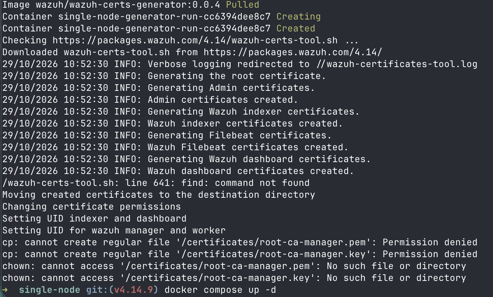

In the first screenshot we can see what I mentioned before. The certificates are generated, but the script cannot create the `root-ca-manager` copies (`cp: ... Permission denied`), because on macOS the folder is already read-only for my user, and it continues without failing. There is also a `find: command not found`, which is a different problem (the generator image does not have `find`) and does not break anything.

### 02. Compose mount error and fix
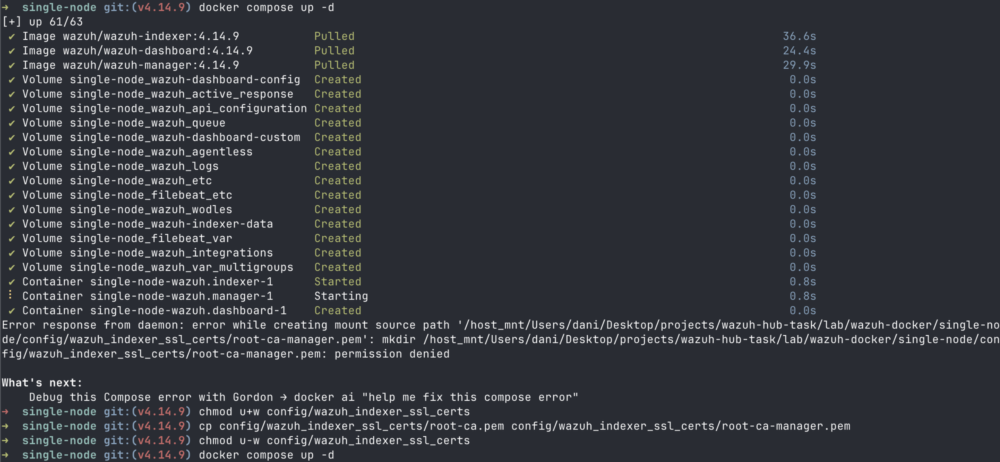

This second screenshot shows the error when starting the containers, because `root-ca-manager.pem` does not exist, and how I fixed it: making the certificates folder writable, copying `root-ca.pem` to `root-ca-manager.pem` and making the folder read-only again.

### 03. Containers up
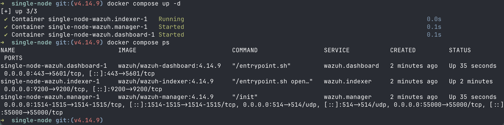

This third screenshot shows the three containers (manager, indexer and dashboard) up and running, with their ports.

### 04. Dashboard overview, no agents yet
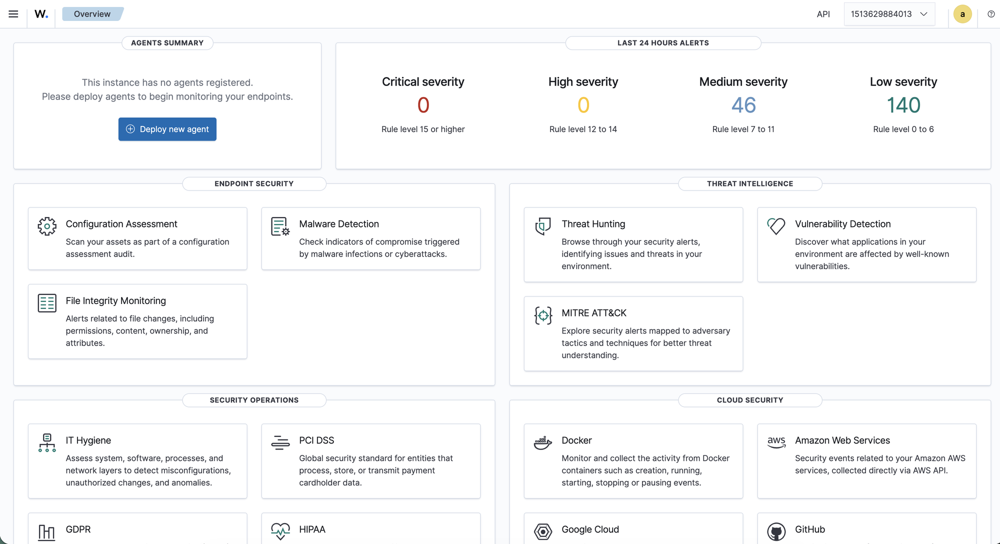

This fourth screenshot shows the dashboard overview, with no agents yet, but we can see that the deployment worked as expected.

### 05. Admin password in the compose environment
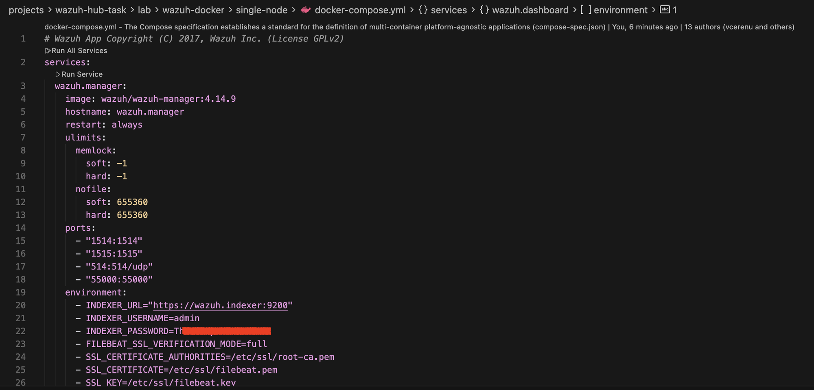

Now, as a first step of security, I wanted to change the default password. I tried to change it using the dashboard, but it told me that the `admin` user is reserved, so I found in the Wazuh docs how to do it and modified everything following them (docker compose yaml, admin hash...). I left the first two letters visible so it can be seen that it is no longer the default password.

### 06. Admin password: securityadmin reload
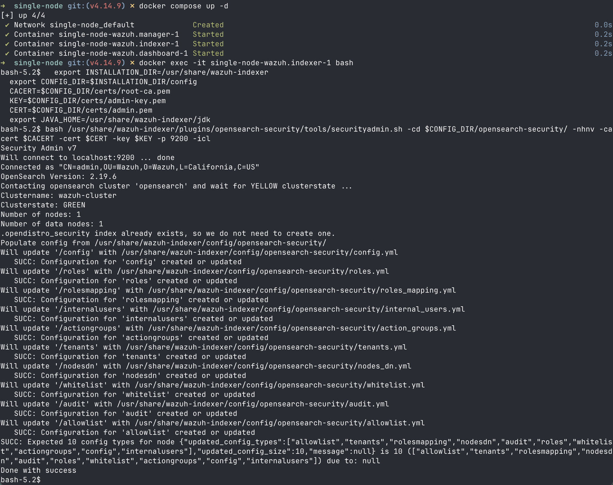

Continuing with the password change, this is the step where the security configuration with the new admin hash is reloaded. After doing this I was able to go to the dashboard and log in with the new password.

### 07. Agent installed and running
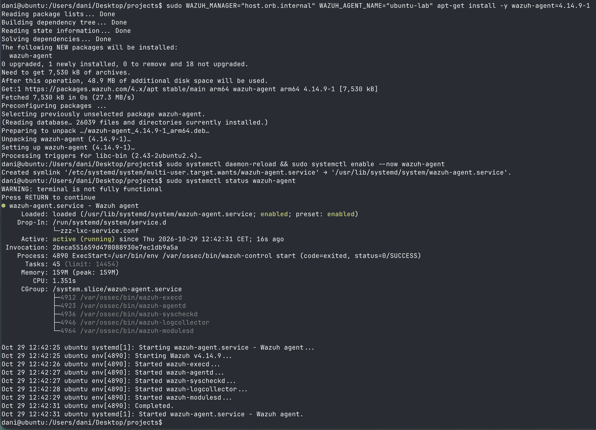

Next step is to have an agent installed and running so we can use the dashboard to monitor it. For this I needed a Linux machine, so I used a VM in OrbStack. Why? Because last summer, during a PoC of Falco for runtime security in Prowler, we needed Linux since Falco only works on Linux, and OrbStack was the alternative we found to deploy VMs easily on a Mac. So I used the same to deploy a Linux machine on my Mac.

### 08. Agent active in the dashboard
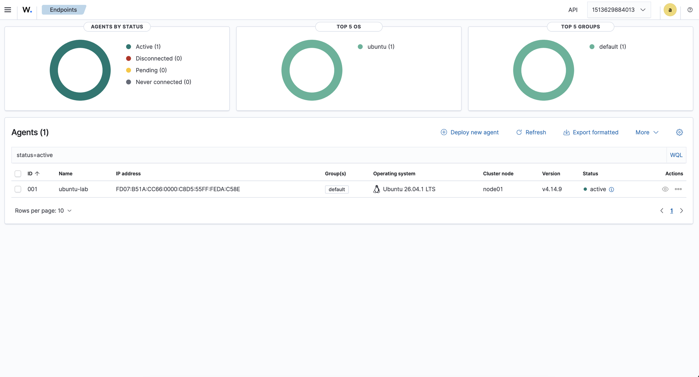

Once the agent was installed without any issue, I was able to see it active in the dashboard.

### 09. SSH brute-force alerts
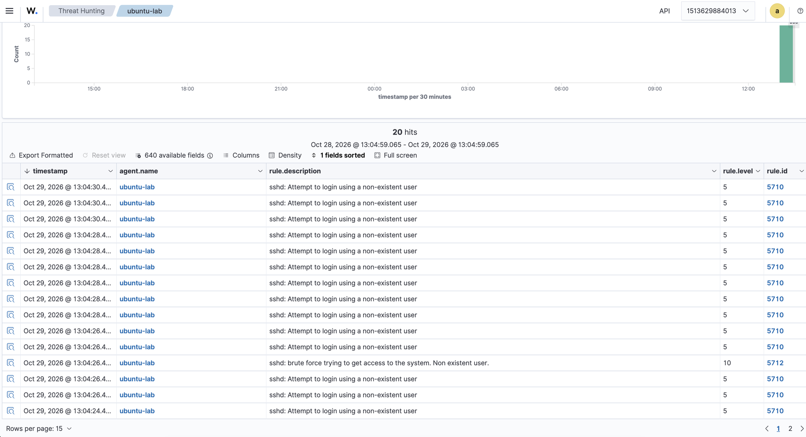

The first thing that I wanted to test was the SSH brute-force alerts, so I installed an SSH server in the agent machine and started to attack it, trying to guess the password and failing every time. In the dashboard I could see all the fails (rule 5710), and also one alert with a higher level (rule 5712) saying it was a brute force.

### 10. FIM real-time config and file changes
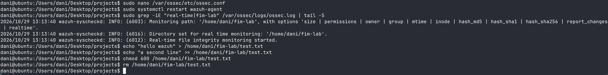

Next thing I wanted to try was tracking changes on a folder. I created a new directory, configured the agent to track it in real time and to report the changes (`realtime` and `report_changes` in `ossec.conf`), and started doing some changes little by little so they would be different events.

### 11. FIM events
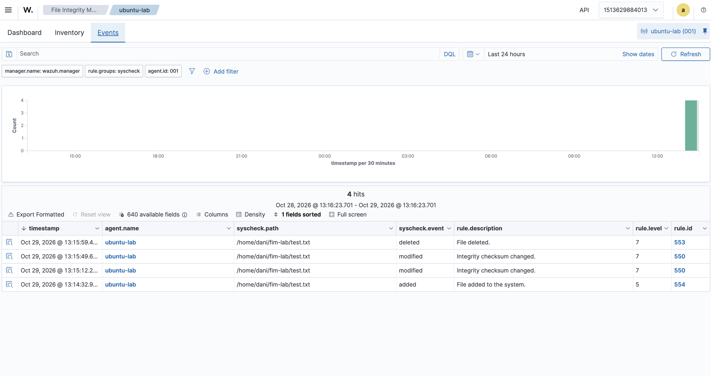

Finally, on the dashboard I could see all of these changes as events: added (554), modified (550) and deleted (553).

This is everything I did for this phase 1. I also looked around the dashboard, seeing all the options, and I noticed that there were two high vulnerabilities (CVE) related to some packages that were installed by default on the Ubuntu machine.

---

*Note: after writing this document I used AI to rewrite some parts and correct typos that I could have after writting on english.*
