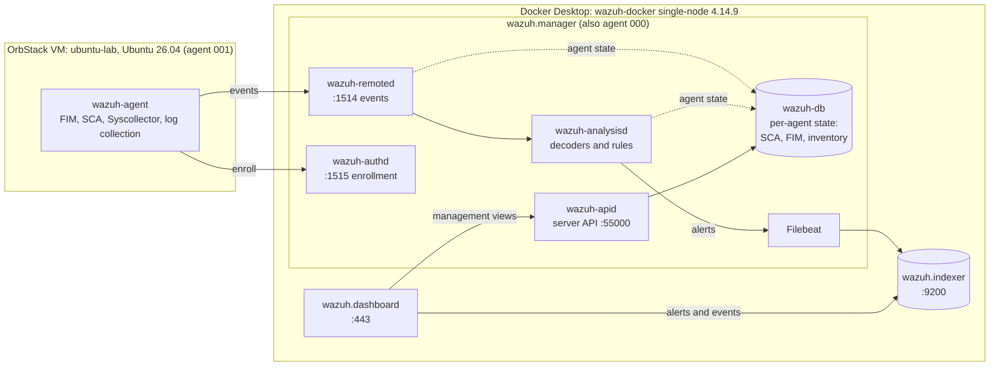
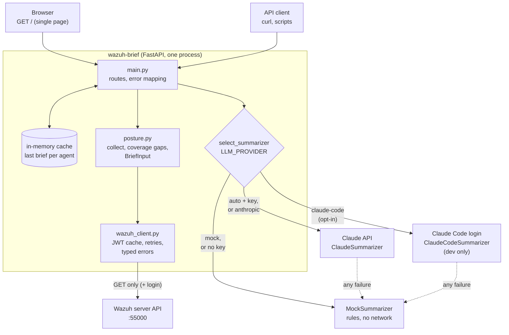
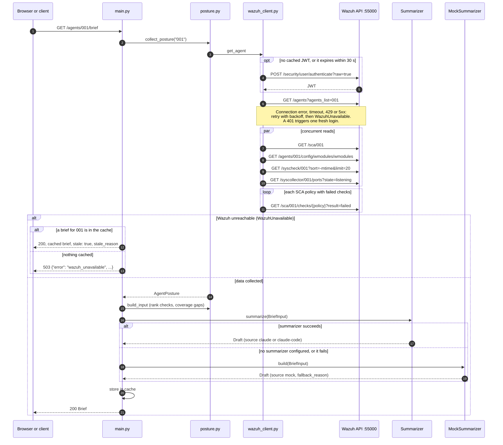

# Architecture

Three views: the lab the service reads from, the service itself, and what happens on one `GET /agents/{id}/brief` request. Everything here is either in the code under [`app/`](../app/) or was checked against the running lab on 2026-10-29 (container ports, running Wazuh daemons, the Filebeat output host and the dashboard's upstream hosts). Wazuh internals are drawn only at that level.

## 1. The lab

| Component | Role | Port on the host |
|---|---|---|
| `wazuh-agent` on `ubuntu-lab` | Collects FIM, SCA, inventory and logs, sends them to the manager | — |
| `wazuh-authd` | Agent enrollment | 1515/tcp |
| `wazuh-remoted` | Receives agent events | 1514/tcp (514/udp is also published, for syslog) |
| `wazuh-analysisd` | Runs decoders and rules, raises alerts | — |
| `wazuh-db` | Current per-agent state that the server API reads | — |
| Filebeat | Ships alerts from the manager to the indexer (`https://wazuh.indexer:9200`) | — |
| `wazuh-apid` | Wazuh server API, the only thing this service talks to | 55000/tcp |
| `wazuh.indexer` | Stores alerts and events | 9200/tcp |
| `wazuh.dashboard` | UI; reads the indexer and calls the server API | 443/tcp |

The dotted edge into `wazuh-db` is deliberately vague: the daemons were checked as running, but which daemon writes which state was not verified, so it is not drawn in detail.

Agent `000` is the manager itself (`wazuh.manager`, Amazon Linux 2023). It runs its own SCA scan, which is why it is the only agent in the lab with SCA results. The service hides it from the agent list but serves its brief.

The service does **not** read the indexer, so alerts and vulnerability detection are out of scope ([ADR 0001](adr/0001-phase2-stack-and-shape.md)). Every brief says so in its coverage gaps.

## 2. The service

| `LLM_PROVIDER` | Primary | Falls back to the mock when |
|---|---|---|
| `auto` (default) | Claude API if `ANTHROPIC_API_KEY` is set | No key; timeout, API error, refusal, `max_tokens`, output that fails the schema |
| `anthropic` | Claude API | Same, and when the key is missing |
| `claude-code` | Agent SDK on the developer's own login, dev only ([ADR 0002](adr/0002-dev-only-agent-sdk-summarizer.md)) | SDK not installed, CLI not found, not logged in, process error, timeout, invalid JSON |
| `mock` | — | Always the mock |

Every brief records `source` (`claude`, `claude-code` or `mock`), `model` and, when the mock ran instead, `fallback_reason`.

## 3. One request: `GET /agents/{id}/brief`

Other outcomes from the same endpoint, all JSON with `error` and `detail`:

| Status | `error` | Cause |
|---|---|---|
| 404 | `agent_not_found` | Wazuh answers HTTP 200 with failed item code 1701, mapped to `WazuhNotFound` |
| 422 | — | Agent ID is not 3 to 5 digits |
| 502 | `wazuh_auth_failed` | Wazuh rejects the configured user or password. The stale cache is not used here: a credentials problem should be visible, not hidden. |
| 502 | `wazuh_api_error` | Any other Wazuh error response |
