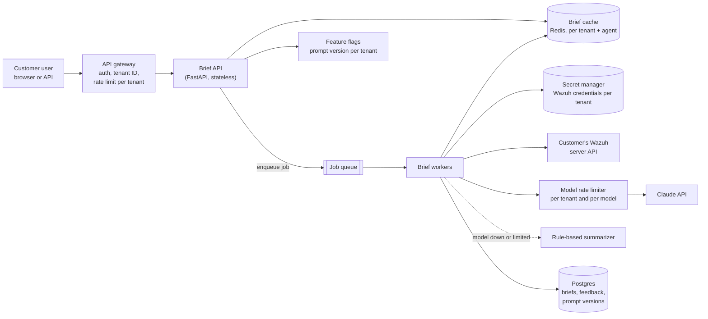
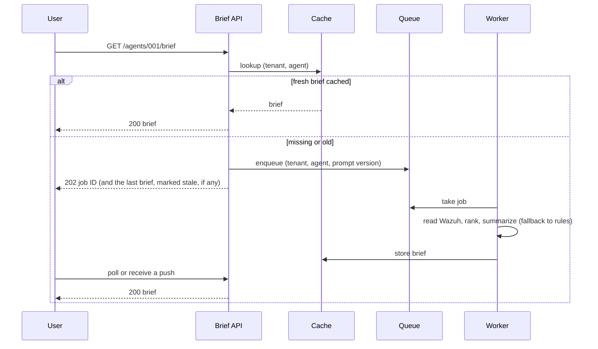
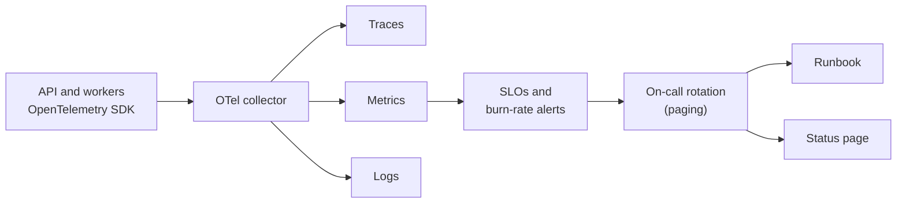
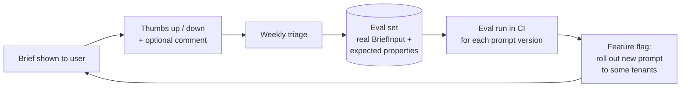
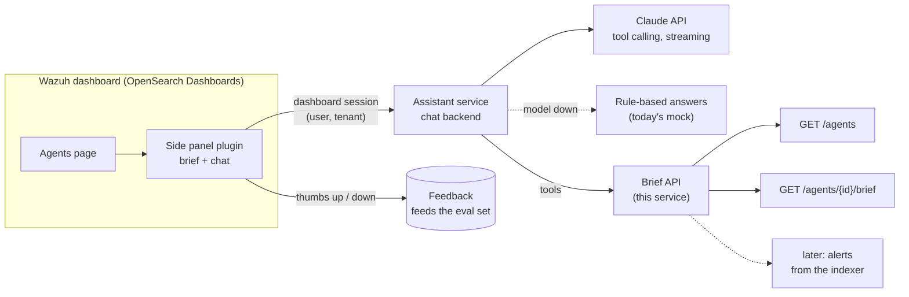

# SaaS target design

**Drawn, not built.** The brief says: if your tools do not let you set up something you would use, draw it and explain how you would set it up on a SaaS team. This page is that drawing. Nothing here exists in the repository unless the last table says so.

The service today is one process that serves one Wazuh deployment ([architecture](architecture.md)). The target serves many customers, each with their own Wazuh, and keeps the same core: a read-only Wazuh client, rule-computed coverage gaps, a small model payload and a deterministic fallback.

## Target architecture

### Multi-tenancy

- Every request carries a tenant ID, set by the gateway from the user's token, never from the request body.
- Each tenant's Wazuh API URL and credentials live in a secret manager (for example AWS Secrets Manager or Vault), keyed by tenant. Workers fetch them per job and never log them. The model never sees them, as today.
- Cache keys, database rows, rate limits, traces and logs all carry the tenant ID, so one tenant's data cannot leak into another's brief and per-tenant problems can be found quickly.
- One shared Wazuh client library (today's `wazuh_client.py`, extracted), so every feature reads Wazuh the same way, with the same retries and typed errors.

### Async generation

- The model call leaves the request path, so a slow model never holds a user's connection open.
- Rate limits sit in two places: per tenant at the gateway, and per tenant and per model in the workers, so one large customer cannot use up the model quota for everyone.
- Today's stale-cache behaviour becomes the normal read path: show the last brief immediately, refresh in the background.

## Observability and operations

| Signal | What I would measure |
|---|---|
| Traces | One trace per brief: gateway, API, queue wait, each Wazuh call, model call, fallback. Tenant ID and prompt version as attributes. |
| Metrics | Brief latency (p50, p95), Wazuh error rate by error type, model error and timeout rate, **fallback rate** (`source=mock` share), queue depth, cache hit rate, tokens and cost per tenant |
| Logs | Structured JSON, tenant ID and trace ID on every line, no credentials and no raw Wazuh data |
| SLOs | For example: 99.5% of brief requests answered (fresh or stale) within 2 s; fallback rate under 5% over 1 h |
| Alerting | Burn-rate alerts on the SLOs page the on-call. Fallback-rate and Wazuh-error alerts open tickets first. |

- A public status page with one component per dependency (brief API, model, Wazuh connectivity), updated from the incident process.
- A runbook per alert. The first version is [`runbook.md`](runbook.md).

## Prompt quality

- Prompts are versioned files, and every brief stores the prompt version and model that produced it.
- Negative feedback becomes eval cases: the anonymized `BriefInput` plus checkable properties (for example "does not report a symlink as world-writable", "says coverage is missing when `sca_applicable` is false"). Both of those came from reviewing real output on this task.
- A new prompt version must not regress the eval set before a feature flag rolls it out gradually.

## Environments and delivery

- **Staging** with a seeded Wazuh: the `wazuh-docker` stack plus agents on known OS versions (one with a CIS policy, one without, to keep the no-SCA path honest), reset on every deploy.
- **CI/CD:** today's lint and test job, plus a container build, the eval run, and a deploy to a **preview environment** per pull request, pointed at the staging Wazuh. Merging to `main` deploys to staging, then production after checks pass, with one-click rollback to the previous image.

## Next: an in-dashboard assistant

**Drawn, not built.** Users already live in the Wazuh dashboard, so the brief should eventually be there too, with a chat on top of it. This is how I would build it.

### How it would work

| Part | Design |
|---|---|
| Dashboard plugin | An OpenSearch Dashboards plugin that adds a side panel to the agent views. It knows the selected agent and shows its brief, then a chat box under it. |
| Chat backend | A separate assistant service. The model gets this service's existing endpoints as tools (`/agents`, `/agents/{id}/brief`; later, alerts from the indexer) and nothing else. It does not query Wazuh or the indexer freely. |
| Auth | Reuse the dashboard session: the plugin forwards the logged-in user, the backend checks it against the dashboard's security plugin and maps it to a tenant. No second login, no credentials in the browser. |
| Fallback | The same as today: when the model is down or rate limited, answer with the rule-computed brief and say so (`source`, `fallback_reason`). |
| Guardrails | The same as today: read-only tools only, minimal fields sent to the model, no raw logs, no credentials. The tools return the same small payloads the brief already uses. |
| Streaming | Answers stream to the panel token by token (server-sent events), so a slow model shows progress instead of a spinner. |
| Feedback | Thumbs up / down on every answer, stored with the prompt version and the tool calls made, and triaged into the eval set (see [Prompt quality](#prompt-quality)). |

### Why it was not built now

- **Toolchain.** A dashboard plugin must be built against the exact OpenSearch Dashboards version shipped in Wazuh 4.14.9, with its Node and build tooling. That is a heavy setup for a small task.
- **A different product.** A chat is not a brief: it needs conversation state, tool calling, and guardrails on every turn, not just on one structured output.
- **Time.** The time budget went to a working, tested brief on real lab data.

### Rollout

| Step | What ships | What it needs |
|---|---|---|
| 1 | A link from the dashboard to this page, with the agent ID in the URL | A dashboard menu link; no plugin |
| 2 | A side panel that shows the brief for the selected agent | The plugin, read-only, calling `/agents/{id}/brief` |
| 3 | Chat with tools in the same panel | The assistant service, streaming, feedback |

## What exists today vs. target

| Area | Today (in this repo) | Target |
|---|---|---|
| Tenancy | One Wazuh, credentials in `app/.env` | Tenant ID on every request, credentials per tenant in a secret manager |
| Request path | Synchronous: Wazuh reads and model call inside the request | Queue and workers, cache-first reads, 202 + job ID |
| Cache | In-memory, per process, used only when Wazuh is unreachable | Shared Redis per tenant and agent, the normal read path |
| Rate limits | None | Per tenant at the gateway, per tenant and model in workers |
| Failure handling | Timeouts, retries with backoff, mock fallback, stale cache, 503/502 with JSON, `fallback_reason` | The same, plus a circuit breaker on Wazuh and the model, and alerts on fallback rate |
| Health | `/healthz`, `/readyz` | The same, plus uptime checks, SLOs, paging, a status page |
| Observability | Python logging | OpenTelemetry traces, metrics and logs |
| Prompt | One prompt in code | Versioned prompts, feature flags, an eval set from feedback |
| Feedback | None | Thumbs up/down per brief, stored with the prompt version |
| Environments | Local lab | Staging with a seeded Wazuh, preview environments per PR |
| CI/CD | GitHub Actions: ruff and pytest | Plus image build, evals, deploys, rollback |
| Dashboard | Standalone page at `/` | Side panel plugin in the Wazuh dashboard, then chat with tools |
| Docs | `CLAUDE.md` docs rule, `docs-keeper` agent, ADRs | Plus a CI docs check and a published OpenAPI contract |
