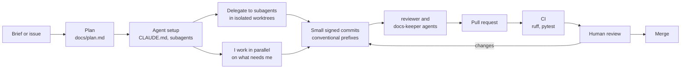
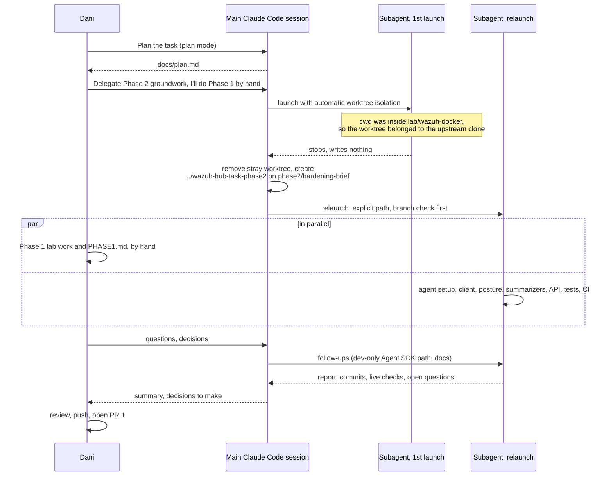
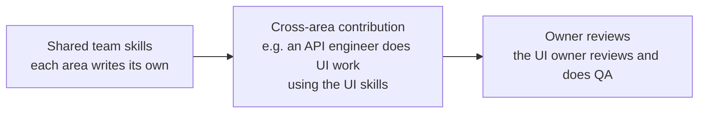

# How I work

The workflow I use and the dev environment I'm comfortable in, with what actually happened on this task as the example. The evidence is in the repo: [`docs/plan.md`](plan.md), [`CLAUDE.md`](../CLAUDE.md), [`.claude/agents/`](../.claude/agents/), [`docs/agent-log.md`](agent-log.md) and the commit history.

## The flow

| Step | What it means here |
|---|---|
| Plan | The work plan was made with Claude Code in plan mode before any lab or code work, and is kept up to date when a decision changes. |
| Agent setup | `CLAUDE.md` holds the stack, commands, conventions and hard rules, so every agent starts from the same rules. The `reviewer` and `docs-keeper` subagents check a diff against them. The agent setup was the first commit of Phase 2, before any code. |
| Delegate | Groundwork goes to a background subagent in its own git worktree and branch. Its prompt is logged verbatim in `docs/agent-log.md`. |
| Parallel work | While the subagent builds, I do the work that has to be mine. Here that was Phase 1, which had to be done without AI. |
| Commits | One logical change per commit, signed, with docs in the same commit as the code they describe. |
| Review | The agents' review comes first, then CI, then me. I read the diff before anything merges. |

## What actually happened on this task

- The main session stayed free for my questions the whole time. The long build ran in the background in a separate worktree, so it never touched the `main` checkout where I was committing Phase 1.
- The first launch landed in the wrong repository. Worktree isolation follows the session's current directory, and that was inside the upstream `wazuh-docker` clone. The subagent noticed and stopped without writing anything, and the main session fixed it by creating the worktree explicitly. Lesson, now in my habits: always check which repository an isolated worktree belongs to ([agent log, Entry 1](agent-log.md#2026-10-29--entry-1-first-delegation-lands-in-the-wrong-repository)).
- Every decision that was mine is recorded as mine: the stack, the provider choices, the password redaction, keeping agent `000` reachable through the API. Choices the subagent made on its own are listed separately in the log so I could review them.

## Dev environment

| Area | Tool |
|---|---|
| Machine | macOS on Apple Silicon |
| Terminal | Ghostty |
| Wazuh stack | Docker Desktop, official `wazuh-docker` single-node compose |
| Linux agent | OrbStack VM (Ubuntu 26.04) |
| Python | `uv` (through mise), ruff, pytest, respx |
| GitHub | `gh` CLI, GitHub Actions for CI |
| AI | Claude Code: `CLAUDE.md`, subagents, skills (the `claude-api` skill was loaded before the model code was written), plan mode, background agents in worktrees |
| Commits | Signed commits, conventional prefixes |

## Working with AI in a team

At Prowler (cloud security, where I lead the detection and remediation team), each area wrote Claude skills for its own part of the product and shared them with the rest of the team.

Someone from the API side could pick up UI work with the UI team's skills, and the UI owner reviewed it and did QA. In my experience the speed-up came from that cross-area work, not from the skills on their own: people could take tasks outside their usual area without waiting for that team, and the owner still kept the quality bar. The same idea is behind `CLAUDE.md` and the subagents here: the conventions and checks are written down once, so whoever (or whatever) makes the change follows them, and a human owner reviews.
